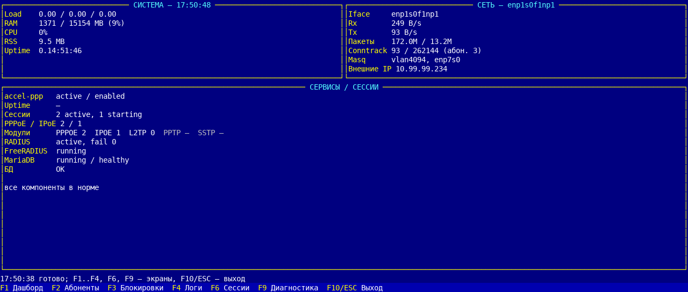
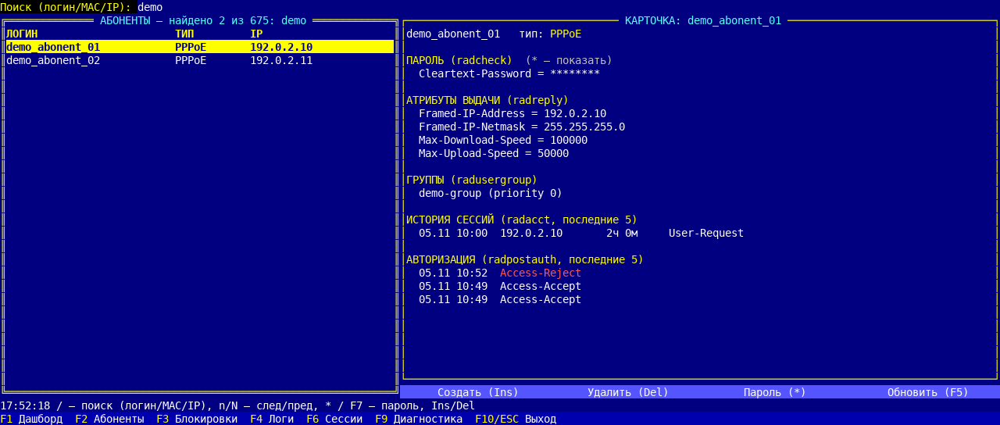
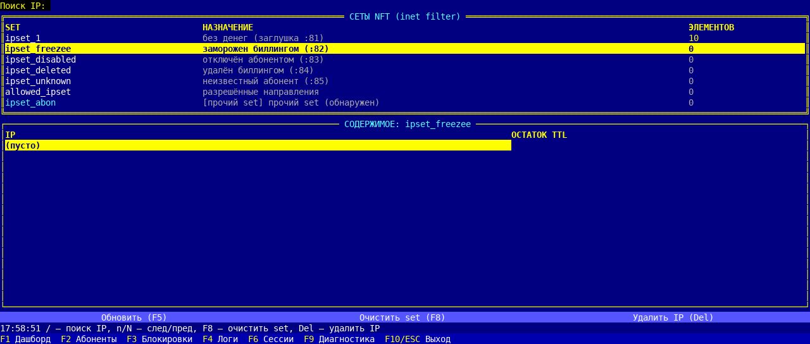
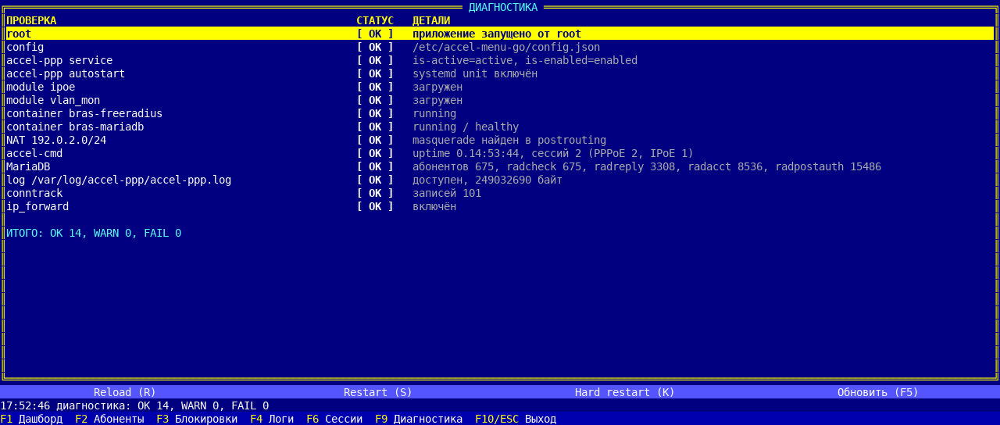

# accel-menu-go

Консольное TUI-приложение для мониторинга и управления BRAS на **accel-ppp + FreeRADIUS + MariaDB**.
Заменяет интерактивный bash-скрипт `accel-menu` и оформлено в стиле FoxPro / Turbo Vision:
тёмно-синий фон, жёлтые рамки, нижняя панель F-клавиш. Успешные статусы — белые
(светло-зелёный плохо читался на голубом фоне терминала), ошибки — красные, предупреждения — жёлтые.

Стек:

- Go 1.27+;
- TUI: [`github.com/rivo/tview`](https://github.com/rivo/tview) v0.42.0, события tcell v2.8.1;
- БД: `database/sql` + [`github.com/go-sql-driver/mysql`](https://github.com/go-sql-driver/mysql) v1.10.1;
- системные утилиты: `accel-cmd`, `nft`, `ip`, `docker`, `bmon` через `os/exec` (без shell).

## Экраны

| Клавиша | Экран | Что показывает |
|---|---|---|
| **F1** | Дашборд | LoadAvg, RAM, CPU/RSS/uptime accel, Rx/Tx и пакеты `enp1s0f1np1`, conntrack, masquerade-интерфейсы и внешние IP, сессии PPPoE/IPoE, **модули авторизации** (PPPoE, IPoE, L2TP, PPTP, SSTP и их active), RADIUS, контейнеры `bras-freeradius` / `bras-mariadb`, статус БД. Обновление каждые 2 с. |
| **F2** | Абоненты | Список `radcheck` (логин, тип, **IP**), поиск по логину/MAC/IP, счётчик в заголовке, `n`/`N` — Find Next/Prev, `*`/`F7` — показать/скрыть пароль в карточке. Карточка: `radreply`, `radusergroup`, последние 5 сессий `radacct`, последние 5 авторизаций `radpostauth` (`Access-Reject` красным). Создание (Ins) с выбором типа PPPoE/IPoE, удаление (Del) с подтверждением. |
| **F3** | Блокировки (nft) | Штатные set-ы `ipset_1`, `ipset_freezee`, `ipset_disabled`, `ipset_deleted`, `ipset_unknown`, `allowed_ipset` + обнаруженные `ipset_*`; количество элементов, IP и остаток TTL. Поиск IP по всем set-ам (`Enter`), `n`/`N` — следующий/предыдущий найденный set. Очистка set-а (F8) и удаление IP (Del) с подтверждением. |
| **F4** | Логи | Хвост `/var/log/accel-ppp/accel-ppp.log` с подсветкой `Access-Reject`, `authentication failed`, `AuthNak`, `warn:`; поиск (`/` или Ctrl+F), сброс (Esc), полоса прокрутки, автообновление 2 с. |
| **F6** | Сессии | Таблица `accel-cmd show sessions` (ifname, username, calling-sid, ip, rate-limit, type, comp, state, uptime), поиск, навигация, `B` — запуск `bmon` по интерфейсу сессии, `Del` — прервать сессию (`accel-cmd terminate if … soft`). |
| **F9** | Диагностика | `[ OK ]` / `[WARN]` / `[FAIL]`: root, accel-ppp active/enabled, модули `ipoe`/`vlan_mon`, контейнеры, NAT `10.92.0.0/24`, `accel-cmd`, MariaDB, лог, conntrack, `ip_forward`. Кнопки/клавиши управления демоном: `R` — reload, `S` — restart, `K` — hard restart. |

Нижняя строка — подсказки F-клавиш, над ней — статус последнего действия/ошибки и контекстные клавиши.
`F5` — обновить текущий экран, `F10` или `Esc` — выход (с подтверждением).
`Tab` / `Shift+Tab` переключают фокус, стрелки — выбор в таблицах и прокрутку.

### Поиск и Find Next

- `/` или `Ctrl+F` — перейти в поле поиска.
- Ввод — фильтрация загруженного хвоста журнала (500 строк), списка сессий или абонентов
  (логин/MAC/IP) без учёта регистра; в логе совпадения подсвечиваются жёлтым.
- `Esc` в поле поиска — очистить фильтр и вернуться к списку.
- `Enter` — перейти от поиска к списку; для F2/F3 — выполнить поиск.
- `n` / `N` (или `Ctrl+N` / `Ctrl+P`) — Find Next / Find Previous по найденным строкам.
- В заголовке F2 отображается количество: `АБОНЕНТЫ — N` или `найдено X из Y`.
- В журнале справа отображается полоса прокрутки (позиция и размер бегунка соответствуют `PgUp`/`PgDn`/стрелкам).

### Абоненты (F2)

- Список: логин, тип авторизации, IP (статический из `radreply` либо последний из `radacct`).
- В форме создания выбор типа: **PPPoE** или **IPoE**; по MAC-логину тип по умолчанию переключается на IPoE.
- IPoE требует MAC-логин; для PPPoE статический IP игнорируется (адрес из пула).
- `*` или `F7` (кнопка «Пароль (*)») показывает пароль в карточке; повторное нажатие скрывает.
  Пароль хранится в БД (radcheck) и в лог/файл настроек не попадает.

### bmon и завершение сессии (F6)

- Выберите сессию стрелками; `Enter` открывает меню действий (bmon / прервать / отмена).
- `B` (или кнопка «bmon (B)») приостанавливает TUI и запускает
  `bmon -p <ifname>` для интерфейса выбранной сессии. Выход из bmon (`q`, затем `y`) возвращает в TUI.
- `Del` (или кнопка «Прервать») показывает подтверждение и выполняет
  `accel-cmd terminate if <ifname> soft`; после этого таблица сессий обновляется.

### Управление accel-ppp (F9)

- `R` — `systemctl reload accel-ppp` (без разрыва сессий).
- `S` — `systemctl restart accel-ppp` (сессии разрываются).
- `K` — `systemctl kill -s SIGKILL` + `systemctl restart` (жёсткий рестарт).
- Все действия требуют подтверждения; после выполнения диагностика обновляется автоматически.

## Сборка

Нужен Go 1.27+ (проверено на go1.27.3) и Linux/macOS/WSL для кросс-сборки.
Сборка статического бинарника под целевой Linux:

```bash
make build
# или
CGO_ENABLED=0 GOOS=linux GOARCH=amd64 go build -trimpath \
  -ldflags "-s -w -X main.version=0.3.0" -o dist/accel-menu-go .
```

Результат — `dist/accel-menu-go` (ELF x86-64, статический).

## Установка на BRAS

```bash
make deploy HOST=admin@bras.example.com
# эквивалент:
scp dist/accel-menu-go admin@bras.example.com:/tmp/accel-menu-go
ssh admin@bras.example.com \
  'sudo -n install -m 0755 /tmp/accel-menu-go /opt/docker/bin/accel-menu-go'
```

Существующие `accel-menu.sh`, `accel-menu-tui`, `accel-menu-old` не перезаписываются.

Перед первым запуском установите файл настроек с логином/паролем БД (раздел «Настройки»):

```bash
make deploy-config HOST=admin@bras.example.com CONFIG=config.json
```

## Запуск

```bash
ssh -t admin@bras.example.com \
  'sudo env TERM=xterm-256color /opt/docker/bin/accel-menu-go'
```

Требуется настоящий TTY (`ssh -t`), иначе tcell не стартует. Запуск от root нужен для чтения
`/var/log/accel-ppp/*.log` (права 600), `/proc/net/nf_conntrack` и работы `nft`.
Если приложение запущено не от root, `nft`/`ip`/`docker` автоматически вызываются через `sudo -n`.

Проверка без TUI (удобно для дежурства и CI):

```bash
sudo /opt/docker/bin/accel-menu-go --check
```

`--check` печатает диагностику и снимок дашборда, завершает кодом `1`, если есть `FAIL`.

## Настройки

**В коде нет логинов и паролей.** Все учётные данные и параметры стенда читаются из JSON-файла:

```
/etc/accel-menu-go/config.json
```

Путь можно переопределить переменной `ACCEL_MENU_CONFIG` (удобно для проверок с временным конфигом).
Файл должен быть доступен только root: `0600`, каталог `0750`.
Шаблон — [config.example.json](config.example.json); реальный `config.json` в git не хранится.

```json
{
  "database": {
    "host": "127.0.0.1:3306",
    "user": "CHANGE_ME",
    "password": "CHANGE_ME",
    "name": "radius"
  },
  "iface": "enp1s0f1np1",
  "log_path": "/var/log/accel-ppp/accel-ppp.log",
  "nft": { "family": "inet", "table": "filter" },
  "networks": { "main": "10.92.0.0/24", "guest": "10.0.0.0/24" },
  "accel_unit": "accel-ppp",
  "radius_container": "bras-freeradius",
  "db_container": "bras-mariadb",
  "refresh": "2s",
  "slow_refresh": "10s",
  "cmd_timeout": "5s",
  "tail_lines": 500,
  "tail_bytes": 524288
}
```

Поля, кроме `database.user` и `database.password`, необязательны и имеют разумные значения
по умолчанию. Для `database` также можно задать `host` (по умолчанию `127.0.0.1:3306`) и `name`.

Установка конфига (файл `config.json` создаётся администратором локально и не коммитится):

```bash
make deploy-config HOST=admin@bras.example.com CONFIG=config.json
# эквивалент:
ssh admin@bras.example.com 'sudo -n install -d -m 0750 /etc/accel-menu-go'
scp config.json admin@bras.example.com:/tmp/accel-menu-go.json
ssh admin@bras.example.com \
  'sudo -n install -m 0600 /tmp/accel-menu-go.json /etc/accel-menu-go/config.json && rm -f /tmp/accel-menu-go.json'
```

`--check` дополнительно проверяет права на файл конфигурации и предупреждает, если он доступен группе/другим.

## Что делает с БД

- Список: `SELECT ... FROM radcheck GROUP BY username`.
- Карточка: `radcheck`, `radreply`, `radusergroup`, последние 5 `radacct`, последние 5 `radpostauth`.
- Создание (одна транзакция):
  - `radcheck` — `Cleartext-Password`;
  - `radreply`:
    - IPoE с IP: `DHCP-Your-IP-Address`, `Framed-IP-Netmask`, `DHCP-Router-Address`, `Max-Download-Speed`, `Max-Upload-Speed`;
    - IPoE без IP: только `Max-*-Speed`;
    - PPPoE: `Framed-Pool=main`, `Framed-Router`, `Max-*-Speed` (статический IP для PPPoE не применяется — как в bash);
  - `radusergroup` — группа `default`, priority 0.
- Удаление: `accel-cmd terminate username <login> soft`, затем удаление из `radcheck`/`radreply`/`radusergroup`.
  История `radacct` не удаляется.

Схема БД не меняется. Значения подставляются только через параметры `?`; пароль нигде не логируется.

## Тесты

```bash
make test        # go test ./...
make race        # go test -race ./...
make vet
```

Интеграционные тесты (создание/удаление на реальной БД) — через SSH-туннель:

```bash
ssh -N -L 13306:127.0.0.1:3306 admin@bras.example.com &
read -r -p 'DB user: ' BRAS_DB_USER
read -r -s -p 'DB pass: ' BRAS_DB_PASS; echo
BRAS_TEST_DSN="${BRAS_DB_USER}:${BRAS_DB_PASS}@tcp(127.0.0.1:13306)/radius?parseTime=true&charset=utf8mb4" \
  go test -tags=integration ./internal/store ./internal/service -v
```

Пароль в команде не хранится; тестовый DSN берётся из введённых переменных.

Тесты создают временных абонентов `zz-*` и удаляют их; после прогона стоит проверить,
что в `radcheck` не осталось `zz-*`.

## Диагностика проблем

- **`terminal entry not found` / пустой экран** — нет TTY или `TERM=dumb`. Запускайте через `ssh -t`
  и `sudo env TERM=xterm-256color …`.
- **`permission denied` на лог** — приложение запущено не от root; лог `accel-ppp.log` доступен только root.
- **`nft: ... Operation not permitted`** — нет root и не настроен passwordless `sudo -n`.
- **`конфигурация: файл настроек …`** — создайте `/etc/accel-menu-go/config.json` с `database.user`
  и `database.password` (шаблон — `config.example.json`). В коде учётных данных нет.
- **`config WARN`** — файл с паролем доступен группе/другим; выполните `chmod 600` и `chown root:root`.
- **`MariaDB FAIL`** — проверьте `docker ps`, `127.0.0.1:3306`, креды в конфиге.
- **TTL показывает `—`** — nft не печатает `expires` для элемента (у set-а нет per-element timeout).
- **`ipset_abon` в списке** — дополнительный set, обнаруженный в `inet filter`; показывается как «прочий set».
- **`bmon: not found`** — на стенде не установлен пакет `bmon`; кнопка/клавиша `B` покажет ошибку.
  Установка: `apt install bmon`.
- **PPPoE-абонент получил адрес из пула, а не введённый** — так работает accel-ppp 1.14; форма
  предупреждает, что для PPPoE статический IP игнорируется.
- **Restart/Hard restart не выполняются** — нужен root или passwordless `sudo -n` для `systemctl`.

## Ограничения

- TUI рассчитан на терминал не уже ~80 колонок; таблицу сессий на узком экране можно
  прокручивать по горизонтали стрелками Left/Right (колонки выбираемы).
- `nft`/`ip`/`docker` требуют прав; без них соответствующие экраны показывают ошибки, но приложение не падает.
- Скорости в существующих данных стенда исторически лежат в `Filter-Id`; форма создаёт
  `Max-Download-Speed`/`Max-Upload-Speed` (как bash-скрипт и ТЗ).
- Деструктивные операции в UI всегда требуют подтверждения, но выполняются сразу после него.

## Скриншоты

Скриншоты сняты с рабочего TUI. Абоненты `demo_*`, адреса `192.0.2.x` и внешний IP
в кадре — **фейковые**; реальные логины и пароли не публикуются.

### Дашборд



### Абоненты



### Блокировки



### Диагностика


